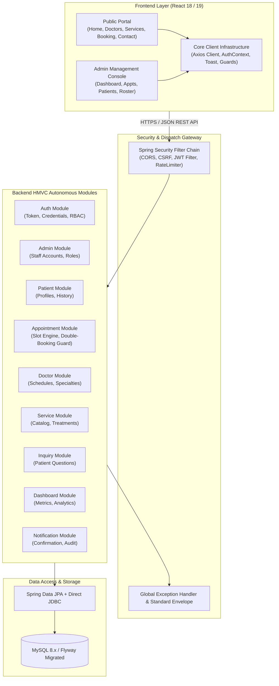
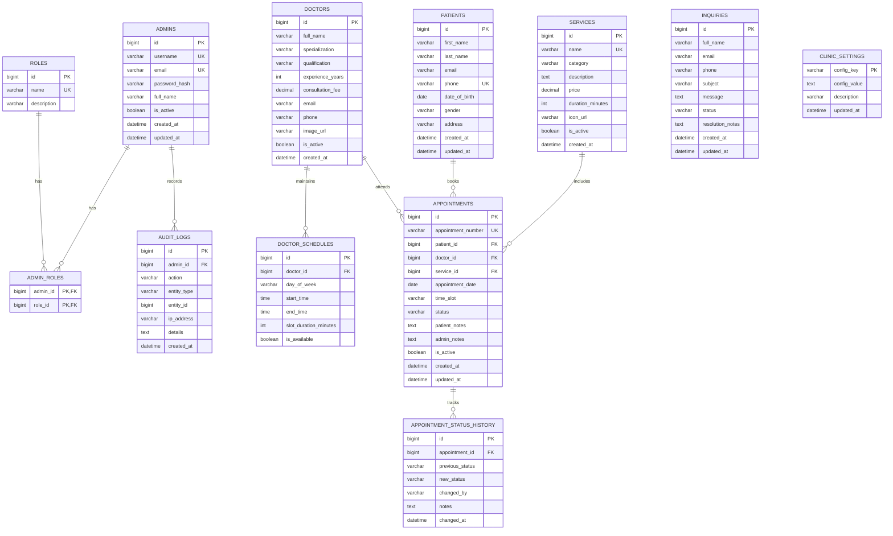

# Akansha Dental Clinic — Architecture & System Specification
## Professional Full-Stack Dental Clinic Management System (HMVC)

---

## 1. System Overview & Vision

**Akansha Dental Clinic** is an enterprise-grade, secure, responsive, and maintainable full-stack dental clinic web application. It integrates a public clinic portal (educating patients, presenting qualified practitioners, showcasing modern dental treatments, and offering online appointment reservations) with a clinic management dashboard for administrators and dental practitioners (orchestrating patient records, appointment lifecycles, doctor rosters, service catalogs, patient inquiries, and operational analytics).

---

## 2. Technology Stack & Runtime Specifications

| Layer | Technology | Version | Purpose |
| :--- | :--- | :--- | :--- |
| **Backend Runtime** | Java SE | 21 LTS | High-performance, secure backend runtime |
| **Backend Framework** | Spring Boot | 3.3.x / 3.4.x | Enterprise application framework |
| **Security** | Spring Security | 6.x | RBAC, BCrypt hashing, JWT / Secure Session validation |
| **Persistence** | Spring Data JPA / Hibernate | 6.x | ORM, transactional concurrency, repository pattern |
| **Direct SQL / Query** | Spring JDBC | 6.x | Optimized batch operations, high-speed reporting queries |
| **Database** | MySQL | 8.x | Production ACID relational database |
| **Test Database** | H2 (MySQL Mode) | 2.x | Zero-friction local dev / automated test suite execution |
| **Migrations** | Flyway | 10.x | Version-controlled, idempotent schema migrations |
| **Frontend Framework** | React.js | 18 / 19 | Declarative component-driven user interface |
| **Bundler & Tooling** | Vite | 5.x / 6.x | High-speed ESM development and production bundling |
| **Routing** | React Router | 6.x | Public and protected role-based routing |
| **HTTP Client** | Axios | 1.7.x | Interceptor-managed REST communications |
| **Styling** | Vanilla CSS3 + Variables | Modern CSS | Navy Blue & Teal palette, responsive grid/flexbox |
| **Containerization** | Docker & Compose | Multi-stage | Reproducible production deployments |

---

## 3. Architecture Pattern: Hierarchical Model-View-Controller (HMVC)

The application adheres strictly to the **HMVC (Hierarchical Model-View-Controller)** paradigm. Rather than bundling all entities, repositories, and controllers into flat, bloated packages, each business capability is an autonomous module that encapsulates its own **Entity/Model**, **Repository/DAO**, **Service/Business Logic**, **Controller/API Boundary**, **DTOs**, and **Validation**.



---

## 4. Directory Layout

### 4.1 Backend (`backend/`)
```
backend/
├── pom.xml                                   # Maven dependencies & build lifecycle
├── src/
│   ├── main/
│   │   ├── java/com/akansha/dental/
│   │   │   ├── DentalClinicApplication.java  # Main application entry point
│   │   │   ├── config/                       # Cross-cutting configurations
│   │   │   │   ├── CorsConfig.java           # Approved origin white-listing
│   │   │   │   ├── WebMvcConfig.java         # Interceptors and resource handlers
│   │   │   │   ├── OpenApiConfig.java        # Swagger/OpenAPI documentation
│   │   │   │   └── AuditConfig.java          # JPA auditing (created_at, updated_at)
│   │   │   ├── security/                     # Enterprise Security
│   │   │   │   ├── SecurityConfig.java       # Filter chain, endpoint rules
│   │   │   │   ├── JwtTokenProvider.java     # Token generation, signing, parsing
│   │   │   │   ├── JwtAuthenticationFilter.java # Header extraction & SecurityContext
│   │   │   │   ├── UserDetailsServiceImpl.java # Admin principal loader
│   │   │   │   ├── RateLimitingFilter.java   # Token-bucket / sliding window rate limiter
│   │   │   │   └── RestAccessDeniedHandler.java # 401/403 JSON envelope handlers
│   │   │   ├── common/                       # Shared models, DTOs & exceptions
│   │   │   │   ├── ApiResponse.java          # Standard JSON envelope { success, message, data }
│   │   │   │   ├── PagedResponse.java        # Pagination envelope { content, page, size, total }
│   │   │   │   ├── GlobalExceptionHandler.java # Custom & standard error handler
│   │   │   │   └── exceptions/               # Custom business runtime exceptions
│   │   │   │       ├── ResourceNotFoundException.java
│   │   │   │       ├── ConflictException.java
│   │   │   │       ├── BadRequestException.java
│   │   │   │       └── UnauthorizedException.java
│   │   │   └── modules/                      # Autonomous HMVC Domain Modules
│   │   │       ├── auth/                     # Authentication & Token Management
│   │   │       │   ├── controller/AuthController.java
│   │   │       │   ├── dto/LoginRequest.java
│   │   │       │   ├── dto/AuthResponse.java
│   │   │       │   └── service/AuthService.java
│   │   │       ├── admin/                    # Admin & Staff User Management
│   │   │       │   ├── controller/AdminController.java
│   │   │       │   ├── entity/AdminUser.java
│   │   │       │   ├── entity/Role.java
│   │   │       │   ├── repository/AdminUserRepository.java
│   │   │       │   ├── repository/RoleRepository.java
│   │   │       │   ├── dto/AdminUserDto.java
│   │   │       │   └── service/AdminService.java
│   │   │       ├── patient/                  # Patient Records & Search
│   │   │       │   ├── controller/PatientController.java
│   │   │       │   ├── entity/Patient.java
│   │   │       │   ├── repository/PatientRepository.java
│   │   │       │   ├── dto/PatientRequestDto.java
│   │   │       │   ├── dto/PatientResponseDto.java
│   │   │       │   └── service/PatientService.java
│   │   │       ├── appointment/              # Appointment Scheduling & Slot Engine
│   │   │       │   ├── controller/AppointmentController.java
│   │   │       │   ├── entity/Appointment.java
│   │   │       │   ├── entity/AppointmentStatus.java
│   │   │       │   ├── entity/AppointmentStatusHistory.java
│   │   │       │   ├── repository/AppointmentRepository.java
│   │   │       │   ├── repository/AppointmentStatusHistoryRepository.java
│   │   │       │   ├── dto/AppointmentBookingRequest.java
│   │   │       │   ├── dto/AppointmentResponseDto.java
│   │   │       │   ├── dto/SlotAvailabilityDto.java
│   │   │       │   └── service/AppointmentService.java
│   │   │       ├── doctor/                   # Doctor Specialist Roster & Schedules
│   │   │       │   ├── controller/DoctorController.java
│   │   │       │   ├── entity/Doctor.java
│   │   │       │   ├── repository/DoctorRepository.java
│   │   │       │   ├── dto/DoctorDto.java
│   │   │       │   └── service/DoctorService.java
│   │   │       ├── service/                  # Dental Service Catalog
│   │   │       │   ├── controller/DentalServiceController.java
│   │   │       │   ├── entity/DentalService.java
│   │   │       │   ├── repository/DentalServiceRepository.java
│   │   │       │   ├── dto/DentalServiceDto.java
│   │   │       │   └── service/DentalCatalogService.java
│   │   │       ├── inquiry/                  # Contact & Consultation Inquiries
│   │   │       │   ├── controller/InquiryController.java
│   │   │       │   ├── entity/Inquiry.java
│   │   │       │   ├── repository/InquiryRepository.java
│   │   │       │   ├── dto/InquiryDto.java
│   │   │       │   └── service/InquiryService.java
│   │   │       ├── dashboard/                # Analytics & Aggregation
│   │   │       │   ├── controller/DashboardController.java
│   │   │       │   ├── dto/DashboardMetricsDto.java
│   │   │       │   └── service/DashboardService.java
│   │   │       └── notification/             # Notification Dispatch & Audit
│   │   │           ├── entity/AuditLog.java
│   │   │           ├── repository/AuditLogRepository.java
│   │   │           └── service/NotificationService.java
│   │   └── resources/
│   │       ├── application.properties        # Base Spring configuration
│   │       ├── application-dev.properties    # H2/Local MySQL config
│   │       ├── application-prod.properties   # Production MySQL & environment variables
│   │       └── db/migration/                 # Flyway Schema Migrations
│   │           ├── V1__create_initial_schema.sql
│   │           └── V2__seed_initial_data.sql
│   └── test/                                 # Unit & Integration Tests
│       ├── java/com/akansha/dental/
│       │   ├── auth/AuthServiceTest.java
│       │   ├── appointment/AppointmentConcurrencyTest.java
│       │   ├── appointment/AppointmentServiceTest.java
│       │   └── patient/PatientServiceTest.java
│       └── resources/
│           └── application-test.properties
```

### 4.2 Frontend (`frontend/`)
```
frontend/
├── package.json                              # Dependencies (react, react-router-dom, axios, lucide-react)
├── vite.config.js                            # Dev proxy to backend on port 8080
├── index.html                                # SEO tags, Favicon, Meta description
├── src/
│   ├── main.jsx                              # Mounts React tree into root
│   ├── App.jsx                               # Master router configuration
│   ├── assets/                               # Clinic logos, icons, vector graphics
│   ├── styles/
│   │   ├── variables.css                     # Palette: Navy (#0A2540), Teal (#00D4B2), White (#FFF)
│   │   ├── index.css                         # Global base, typography, resets
│   │   └── layout.css                        # Containers, grids, hero banners, tables
│   ├── components/                           # Shared UI components
│   │   ├── Navbar.jsx                        # Responsive sticky header with mobile drawer
│   │   ├── Footer.jsx                        # Professional clinic footer with quick links
│   │   ├── Button.jsx                        # Accessible, styled primary/secondary buttons
│   │   ├── Input.jsx                         # Form input with validation feedback
│   │   ├── Modal.jsx                         # Accessible dialog with overlay
│   │   ├── Toast.jsx                         # Floating notification alerts
│   │   ├── Spinner.jsx                       # Modern SVG loading spinner
│   │   ├── Badge.jsx                         # Status indicators (PENDING, CONFIRMED, etc.)
│   │   └── Pagination.jsx                    # Reusable page navigation
│   ├── layouts/                              # Page shell layouts
│   │   ├── PublicLayout.jsx                  # Navbar + Page content + Footer
│   │   └── AdminLayout.jsx                   # Admin Sidebar + Header + Page content
│   ├── context/                              # Shared state providers
│   │   ├── AuthContext.jsx                   # User session, JWT persistence, roles
│   │   └── ToastContext.jsx                  # Global trigger for alerts
│   ├── hooks/                                # Custom reusable hooks
│   │   ├── useAuth.js
│   │   ├── useToast.js
│   │   └── useDebounce.js
│   ├── services/                             # API service clients
│   │   ├── apiClient.js                      # Axios instance with auth interceptors
│   │   ├── authService.js
│   │   ├── appointmentService.js
│   │   ├── patientService.js
│   │   ├── doctorService.js
│   │   ├── catalogService.js
│   │   ├── inquiryService.js
│   │   └── dashboardService.js
│   ├── utils/                                # Helpers & formatting
│   │   ├── dateFormatter.js
│   │   ├── slotHelper.js
│   │   └── validators.js
│   ├── features/                             # Modular feature sub-components
│   │   ├── auth/                             # Login forms & profile badges
│   │   ├── appointments/                     # Slot picker, booking modal, status switcher
│   │   ├── patients/                         # Patient record table, medical summary
│   │   ├── doctors/                          # Doctor cards, schedule editor
│   │   ├── services/                         # Treatment cards, category filter
│   │   ├── inquiries/                        # Inquiry resolution list & response note
│   │   └── dashboard/                        # Stat cards, revenue/appt chart widget
│   └── pages/                                # Route views
│       ├── public/
│       │   ├── HomePage.jsx                  # Hero, Doctor highlights, Services, CTA
│       │   ├── AboutUsPage.jsx               # Clinic history, technology, safety protocols
│       │   ├── DoctorsPage.jsx               # Full doctor roster with qualifications
│       │   ├── ServicesPage.jsx              # Service catalog with pricing/descriptions
│       │   ├── ServiceDetailPage.jsx         # In-depth treatment overview
│       │   ├── AppointmentBookingPage.jsx    # Real-time multi-step appointment scheduler
│       │   ├── ContactUsPage.jsx             # Contact form, Google Maps, working hours
│       │   ├── GalleryPage.jsx               # Clinic facility & equipment photos
│       │   ├── PrivacyPolicyPage.jsx         # Legal privacy statement
│       │   ├── TermsConditionsPage.jsx       # Terms of service
│       │   └── NotFoundPage.jsx              # 404 handler
│       └── admin/
│           ├── AdminLoginPage.jsx            # Secure admin authentication form
│           ├── DashboardOverviewPage.jsx     # Aggregated stats, quick actions, charts
│           ├── AppointmentsManagerPage.jsx   # Tabular CRUD, date & status filter, actions
│           ├── PatientsManagerPage.jsx       # Patient directory, medical history view
│           ├── DoctorsManagerPage.jsx        # Specialist management & working days
│           ├── ServicesManagerPage.jsx       # Dental treatment catalog manager
│           ├── InquiriesManagerPage.jsx      # Patient messages & status handler
│           └── AdminProfilePage.jsx          # Password change & active session detail
```

---

## 5. Normalized Database Design (MySQL 8.x)

### 5.1 Tables Specification
1. **`roles`**: System roles (`SUPER_ADMIN`, `ADMIN`, `STAFF`).
2. **`admins`**: Administrative personnel credentials, contact info, and activity status.
3. **`admin_roles`**: Join table mapping admins to roles (Many-to-Many).
4. **`patients`**: Patient demographics, unique phone/email index, created timestamps.
5. **`doctors`**: Dental specialists, qualifications, experience years, bio, consultation fee, active status.
6. **`doctor_schedules`**: Available days and working hours for each doctor.
7. **`services`**: Dental treatments (e.g., Teeth Whitening, Root Canal, Orthodontics, Implants), duration minutes, base price, active status.
8. **`appointments`**: Core appointment records linking patient, doctor, service, appointment date, time slot, status (`PENDING`, `CONFIRMED`, `COMPLETED`, `CANCELLED`), and cancellation reason.
9. **`appointment_status_history`**: Audit trail of status transitions with timestamp and actor.
10. **`inquiries`**: General contact inquiries from public website visitors with resolution status (`NEW`, `IN_REVIEW`, `RESOLVED`).
11. **`clinic_settings`**: Key-value pairs for clinic operational parameters (clinic name, phone, email, address, working hours, emergency line).
12. **`audit_logs`**: System audit trail capturing sensitive administrative actions, IP addresses, and timestamps.

### 5.2 Concurrency & Double-Booking Prevention Strategy
To ensure that two concurrent booking requests cannot book the same doctor at the same date and time slot:
1. **Database Constraint**: A unique composite constraint on active appointments:
   ```sql
   UNIQUE KEY uq_doctor_slot (doctor_id, appointment_date, time_slot, is_active)
   ```
   *(Cancelled appointments set `is_active = FALSE` or NULL in standard MySQL to allow rescheduling into previously cancelled slots).*
2. **Pessimistic Locking / Serializable Transaction**:
   The `AppointmentService.bookAppointment()` method runs in a `@Transactional(isolation = Isolation.READ_COMMITTED)` boundary. When checking slot availability, it executes a `SELECT ... FOR UPDATE` or checks slot availability inside an atomic insertion with catch on `DataIntegrityViolationException`, returning a clean HTTP 409 Conflict if a race condition occurs.

### 5.3 Mermaid Entity-Relationship Diagram



---

## 6. Security Architecture

1. **Authentication**:
   - Admin credentials verified against BCrypt (12 rounds) salted hash.
   - Issues short-lived signed JWT tokens containing admin ID, username, and assigned roles.
   - Header: `Authorization: Bearer <jwt_token>`.
2. **Authorization & RBAC**:
   - `SUPER_ADMIN`: Full access to clinic settings, staff accounts, all records, and audit logs.
   - `ADMIN`: Full access to appointments, patients, doctors, services, and inquiries.
   - `STAFF`: Read and update access to appointments and inquiries; restricted from deleting patient records or altering doctor pricing/services.
3. **Public API Hardening**:
   - Public booking endpoint `/api/v1/appointments` requires only essential contact information (Name, Phone, Email, Doctor, Service, Date, Slot).
   - Rate limiting applied to prevent booking spam and credential brute-forcing.
   - Server validates all inputs with Bean Validation (`@Valid`, `@NotBlank`, `@Email`, `@Pattern`).
4. **Data Privacy**:
   - Public endpoints never expose admin hashes, patient databases, or audit logs.
   - Database credentials and secrets supplied exclusively through environment variables (`DB_URL`, `DB_USERNAME`, `DB_PASSWORD`, `JWT_SECRET`).

---

## 7. REST API Endpoints Specification

### 7.1 Authentication Module (`/api/v1/auth`)
- `POST /api/v1/auth/login` — Authenticate admin/staff user, returns JWT & user profile.
- `POST /api/v1/auth/logout` — Invalidate user session.
- `GET  /api/v1/auth/me` — Retrieve active authenticated user profile & permissions.

### 7.2 Appointment Module (`/api/v1/appointments`)
- `POST /api/v1/appointments` — Public booking request submission with validation & concurrency guard.
- `GET  /api/v1/appointments/available-slots` — Public query for available time slots for a given doctor & date.
- `GET  /api/v1/appointments` — Admin search & filter appointments (pagination, date range, status, doctor).
- `GET  /api/v1/appointments/{id}` — Admin view appointment detail and status history.
- `PATCH /api/v1/appointments/{id}/status` — Admin update appointment status (`CONFIRMED`, `COMPLETED`, `CANCELLED`).
- `DELETE /api/v1/appointments/{id}` — Admin cancel or purge appointment (Super Admin).

### 7.3 Patient Module (`/api/v1/patients`)
- `GET  /api/v1/patients` — Admin search & filter patient records (paginated).
- `GET  /api/v1/patients/{id}` — Admin view patient details and appointment history.
- `POST /api/v1/patients` — Admin manually register a patient.
- `PUT  /api/v1/patients/{id}` — Admin update patient profile.
- `DELETE /api/v1/patients/{id}` — Admin deactivate or remove patient record.

### 7.4 Doctor Module (`/api/v1/doctors`)
- `GET  /api/v1/doctors` — Public list of active doctors with specialties and profile info.
- `GET  /api/v1/doctors/{id}` — Public view of doctor profile and schedule.
- `POST /api/v1/doctors` — Admin create doctor profile.
- `PUT  /api/v1/doctors/{id}` — Admin update doctor details and schedule.
- `PATCH /api/v1/doctors/{id}/status` — Admin toggle doctor active status.

### 7.5 Dental Service Catalog (`/api/v1/services`)
- `GET  /api/v1/services` — Public list of all available dental treatments.
- `GET  /api/v1/services/{id}` — Public view of specific service details.
- `POST /api/v1/services` — Admin add a new dental service.
- `PUT  /api/v1/services/{id}` — Admin update treatment information & pricing.
- `DELETE /api/v1/services/{id}` — Admin soft-delete / deactivate treatment.

### 7.6 Inquiry Module (`/api/v1/inquiries`)
- `POST /api/v1/inquiries` — Public submission of contact/consultation inquiry.
- `GET  /api/v1/inquiries` — Admin list of inquiries with status filters.
- `PATCH /api/v1/inquiries/{id}` — Admin update status and resolution notes.

### 7.7 Dashboard & Analytics (`/api/v1/dashboard`)
- `GET  /api/v1/dashboard/summary` — Aggregated KPI metrics: total, pending, confirmed, completed appointments, total patients, upcoming roster.
- `GET  /api/v1/dashboard/trends` — Weekly/monthly appointment trends for visualization.

### 7.8 Clinic Settings (`/api/v1/settings`)
- `GET  /api/v1/settings` — Public clinic operational info (address, phone, working hours).
- `PUT  /api/v1/settings` — Super Admin update clinic settings.

---

## 8. Development Roadmap & Execution Strategy

1. **PHASE 1**: Project Planning, Architecture, Directory Blueprint & Prerequisites Verification *(Completed)*.
2. **PHASE 2**: Development Environment & Scaffolding (Maven root, Spring Boot backend skeleton, Vite React frontend skeleton, configuration files).
3. **PHASE 3**: MySQL Schema & Flyway Migrations (V1 DDL, V2 Seed data, H2/MySQL dual-mode verification).
4. **PHASE 4**: Spring Boot Backend & HMVC Modules (Controllers, Services, Repositories, DTOs, Validation, Global Exception handling).
5. **PHASE 5**: React Frontend & Professional UI (Navy & Teal dental theme, responsive layouts, Public pages: Home, Doctors, Services, Booking, Contact, Gallery).
6. **PHASE 6**: REST API Integration (Axios client, request interceptors, real-time slot checking, appointment booking flow).
7. **PHASE 7**: Authentication & Security (Spring Security, BCrypt, JWT generation/filter, rate limiting, protected routes in React).
8. **PHASE 8**: Admin Dashboard & Management Features (KPI summary cards, appointments manager, patients manager, doctors & services manager, inquiry resolver).
9. **PHASE 9**: Automated & Manual Testing (JUnit 5, Mockito service tests, concurrency double-booking tests, validation tests).
10. **PHASE 10**: Performance, SEO & Accessibility (Semantic tags, meta descriptions, sitemap.xml, robots.txt, lazy loading, responsive audits).
11. **PHASE 11**: Docker & Production Deployment (Multi-stage Dockerfile for backend & frontend, docker-compose.yml, environment variables guide).
12. **PHASE 12**: Comprehensive Documentation & Final Handover.
