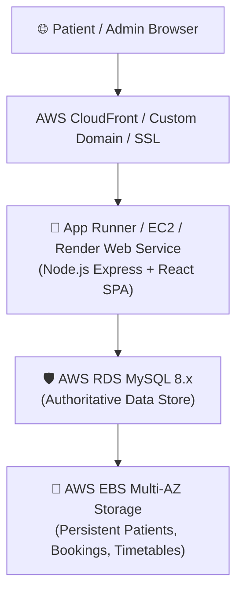

# 🚀 AWS Production Deployment & RDS MySQL Migration Guide
**Akansha Dental Clinic & Implant Center**

This guide provides step-by-step instructions to deploy the Akansha Dental Clinic application on AWS with a fully managed, persistent **AWS RDS MySQL Database** ensuring 100% data durability across restarts, deployments, and cold boots.

---

## 🏗️ Architecture Overview



- **Application Server**: AWS App Runner, Elastic Beanstalk, EC2, or Render Web Service.
- **Database**: AWS RDS MySQL 8.x (Multi-AZ or Single-AZ Free Tier `db.t4g.micro` / `db.t3.micro`).
- **Data Persistence**: Zero reliance on ephemeral container disks. All patient registrations, appointment bookings, and doctor schedules are stored directly in AWS RDS.

---

## 🛠️ Step 1: Create AWS RDS MySQL Database

1. Log in to your [AWS Management Console](https://console.aws.amazon.com/).
2. Navigate to **RDS** (Relational Database Service) in your preferred region (e.g. `ap-south-1` Mumbai).
3. Click **Create database**:
   - **Database creation method**: Standard create.
   - **Engine type**: **MySQL**.
   - **Engine Version**: MySQL 8.0.x (e.g., 8.0.36 or higher).
   - **Templates**: Select **Free tier** (gives 750 hours/month of `db.t3.micro`/`db.t4g.micro` + 20 GB SSD storage free for 12 months).
4. **Settings**:
   - **DB instance identifier**: `akansha-dental-db`
   - **Master username**: `admin`
   - **Master password**: Enter a strong password (e.g., `AkanshaDental@AwsRds2026!`).
5. **Instance configuration**:
   - DB instance class: `db.t4g.micro` or `db.t3.micro`.
6. **Connectivity**:
   - **Public access**: 
     - Select **Yes** if deploying the Node.js backend outside AWS VPC (e.g., on Render or Netlify/Vercel serverless).
     - Select **No** if running backend on AWS App Runner/EC2 inside the same VPC.
   - **VPC security group**: Choose or create a security group (e.g., `akansha-rds-sg`).
7. **Additional configuration** (Crucial):
   - **Initial database name**: `akansha_dental_db` *(Required so AWS creates the database schema automatically)*.
   - Backup retention: 7 days.
8. Click **Create database** and wait 5–10 minutes until status is **Available**.
9. In the database details, note down the **Endpoint** (e.g. `akansha-dental-db.cxyz123.ap-south-1.rds.amazonaws.com`).

---

## 🔒 Step 2: Configure RDS Security Group (Firewall)

To allow your web service to connect to RDS:
1. Under **Connectivity & security**, click your VPC security group link.
2. In the **Inbound rules** tab, click **Edit inbound rules**:
   - **Type**: `MYSQL/Aurora`
   - **Protocol**: `TCP`
   - **Port range**: `3306`
   - **Source**: 
     - If connecting from Render/external host: `Anywhere-IPv4` (`0.0.0.0/0`).
     - If connecting from AWS App Runner/EC2: Select the Security Group of your App Runner service or EC2 instance.
3. Click **Save rules**.

---

## ⚙️ Step 3: Configure Environment Variables

Set the following environment variables in your hosting provider (AWS App Runner or Render Dashboard -> Environment):

| Environment Variable | Value Example | Description |
| :--- | :--- | :--- |
| `NODE_ENV` | `production` | Enables production optimizations. |
| `PORT` | `8080` | Port for the Express server. |
| `JWT_SECRET` | *(64+ random hex characters)* | Cryptographic key for signing admin authentication tokens. |
| `ADMIN_INITIAL_EMAIL` | `admin@akanshadental.com` | Primary Super Administrator login email. |
| `ADMIN_INITIAL_PASSWORD` | `YourStrongAdminPassword2026!` | Initial Super Admin password (must be changed upon first login). |
| `DB_HOST` | `akansha-dental-db.cxyz123.ap-south-1.rds.amazonaws.com` | Your AWS RDS MySQL endpoint. |
| `DB_PORT` | `3306` | MySQL port. |
| `DB_USER` | `admin` | Your RDS master username. |
| `DB_PASSWORD` | `YourRdsPasswordHere` | Your RDS master password. |
| `DB_NAME` | `akansha_dental_db` | Your initial database name. |
| `DB_SSL` | `true` | Enforces SSL encryption for all database traffic. |

---

## 🔄 Step 4: Automated Schema & One-Time Data Migration

You **do not need to manually import SQL tables**. The backend includes an automated bootstrapper (`backend/database/bootstrap.js`):

1. On the very first startup when connecting to AWS RDS, the server:
   - Reads `backend/database/schema.sql` and automatically creates all 11 tables (`roles`, `admins`, `patients`, `doctors`, `doctor_schedules`, `services`, `appointments`, `appointment_status_history`, `inquiries`, `audit_logs`, `settings`).
   - Verifies the unique index `uq_active_doctor_slot (doctor_id, appointment_date, time_slot)` to prevent double bookings.
   - Provisions the primary Super Admin account in MySQL using your `ADMIN_INITIAL_EMAIL` and `ADMIN_INITIAL_PASSWORD`.
   - Performs a **one-time import** of doctors, OPD schedules, treatments catalog, and clinic settings from `clinic_data.json` into MySQL.
2. From this moment onward:
   - **All reads and writes interact exclusively with AWS RDS MySQL**.
   - Container restarts, deploys, or sleeping instances will **never** wipe your patients or appointment bookings.

---

## 🩺 Step 5: Verify Deployment Health

Test your live service by visiting the health endpoint:

```bash
curl https://your-app-domain.com/api/health
```

Expected JSON response:
```json
{
  "status": "UP",
  "service": "Akansha Dental Clinic REST API",
  "version": "1.0.0",
  "database": "CONNECTED",
  "engine": "MySQL (AWS RDS Managed)",
  "persistence": "DURABLE_MANAGED_DATABASE",
  "host": "akansha-dental-db.cxyz123.ap-south-1.rds.amazonaws.com",
  "timestamp": "2026-11-27T11:15:00.000Z"
}
```

Notice:
- `database: "CONNECTED"` indicates direct link to AWS RDS.
- `persistence: "DURABLE_MANAGED_DATABASE"` confirms your data is safe and permanent.

---

## 🚀 Step 6: Deploying with AWS App Runner (Optional Native AWS Hosting)

If you wish to host the entire web container natively on AWS App Runner:
1. In AWS Console, go to **AWS App Runner** -> **Create service**.
2. **Source**: Select **Source code repository** -> Connect GitHub -> select `LokeshAgnihotri74/akansha-dental-clinic` (branch `main`).
3. **Build settings**:
   - Runtime: `Node.js 18` or `Node.js 20`.
   - Build command: `cd akansha-dental-clinic/frontend && npm install && npm run build && cd ../backend && npm install`
   - Start command: `node akansha-dental-clinic/backend/server.js`
   - Port: `8080`
4. **Environment variables**: Add the variables from **Step 3**.
5. Click **Create & Deploy**. App Runner provides an automated HTTPS domain with auto-scaling.
